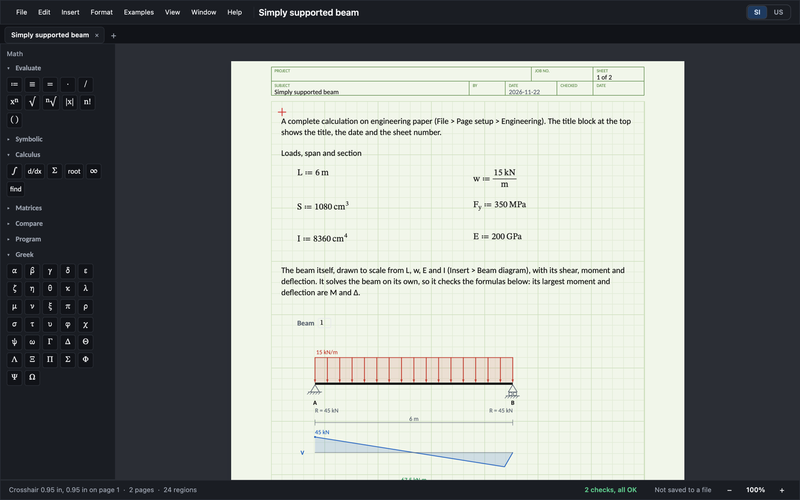
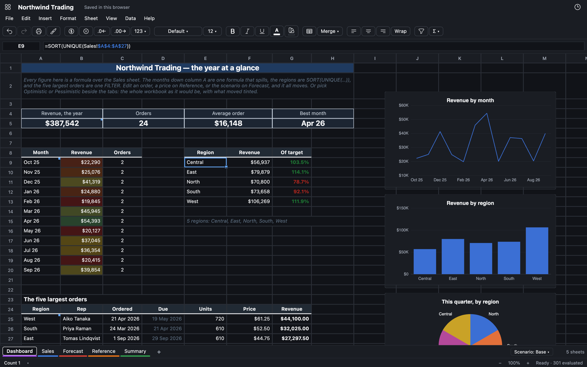
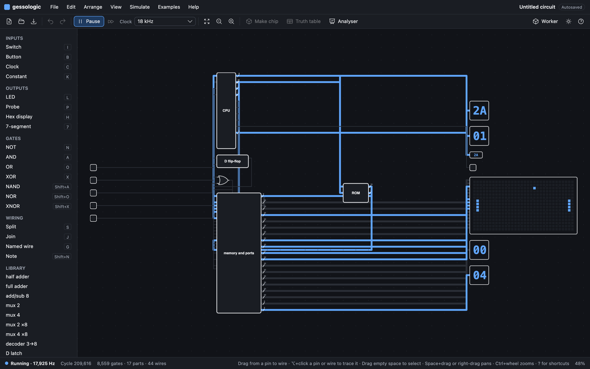

<div align="center">


# Gesso

### Fast apps your AI can drive. On the web and the desktop.

[](https://www.npmjs.com/package/gesso-framework)
[](https://github.com/kevinpbaker/gesso/actions/workflows/ci.yml)
[](LICENSE)

**Fast.** Gesso draws the whole interface from a worker, so your code can work as hard as it likes and the app never drops a frame.<br>
**AI first.** Every Gesso app is an MCP server with nothing more written. Your users' own AI reads the screen and uses the app.<br>
**Runs anywhere.** One codebase ships to any web host, or as a native app on Mac, Windows and Linux through Electrobun.

```bash
pnpm create gesso-app my-app
```

**[Try it live](https://gesso-docs.vercel.app)** · [Built with Gesso](#built-with-gesso) · [Fast](#fast) · [AI first](#ai-first) · [Runs anywhere](#runs-anywhere) · [The code](#thirty-seconds-of-code) · [Proof](#proof-not-promises)

_gesso_ (**JESS**-oh): the primer coat that makes a raw canvas take paint.

</div>

---

## Built with Gesso

Three applications, each drawn entirely by Gesso. Open any of them in a browser.

**[Calcwright](https://calcwright.app)**: an engineering calculation worksheet, like Mathcad. Type the math with its units; the results, the OK or NG checks and the beam drawn from the values follow.

[](https://calcwright.app)

**[Gesso Sheets](https://gesso-sheets.vercel.app/)**: a spreadsheet. Formulas that spill, charts and scenarios across a workbook of five sheets.

[](https://gesso-sheets.vercel.app/)

**[gessologic](https://gesso-logic.vercel.app/)**: a logic simulator. On screen, an 8-bit CPU of 8,559 gates plays Pong at 18 kHz while you rewire it, and neither the game nor the editor drops a frame.

[](https://gesso-logic.vercel.app/)

## Fast

Every web framework you have used shares one thread between your work and your interface. Parse a file, diff a document, simulate a system, sort a hundred thousand rows, and the person using the app watches the two take turns. The pointer sticks. The list stutters mid-scroll. The keystroke lands a beat late.

The usual fix is to move the work into a worker and post the results back. By hand. Per feature. Forever.

Gesso moves the **interface** instead, and moves it once. Layout is its own, paint is an `OffscreenCanvas`, and the main thread's only job is to forward input. Your application gets a worker of its own and talks to the interface over a `MessageChannel` that never touches main. The frame rate does not depend on how busy your code is.

Two copies of the same component, one in a render worker and one on the main thread, each ticking every 40 ms. Block the main thread for three seconds:

|                 | Worst gap between two ticks |
| --------------- | --------------------------: |
| **Main thread** |                    3,010 ms |
| **Gesso**       |                       41 ms |

The worker copy did not miss a tick. Press the button yourself on [Why Gesso](https://gesso-docs.vercel.app/guide/why-gesso).

- **An 18 kB main thread.** The shell is 18.5 kB gzipped against a <!-- proof:shell-budget-kb -->20<!-- /proof --> kB budget CI enforces, and CI greps its bytes for Canvas2D calls so the engine cannot creep back onto the thread it was moved off.
- **Cost follows the change, not the tree.** A text edit deep in a 10k-node page re-measures fewer than 20 nodes. A scroll frame re-measures zero. Those are CI budgets, not hopes.
- **A hundred thousand rows.** `LazyColumn` mounts the rows on screen plus an overscan band, and keeps the row under your eye still when estimates above it are corrected.
- **Idle means idle.** An app with nothing moving reports `ticks 0.00` in its frame metrics.
- **Canvas2D or WebGPU.** Two renderers read the same layout and are pixel-diffed against each other; the framework picks one at runtime.

## AI first

A Gesso app already declares what it holds and what it can be asked to do, as channels of plain data and typed commands, and already describes its screen as a semantics tree for assistive technology. Those are an AI agent's tools, so **every Gesso app is an MCP server with nothing more written.**

```ts
/** The notes the person has written. */
export const Notes = defineChannel('notes', {
  view: { rows: [] as readonly NoteRow[] },
  commands: {} as {
    /** Opens a note in the editor. @param id The note's id. */
    open(id: string): void;
    /** Deletes a note for good. @destructive @confirm */
    remove(id: string): void;
  }
});
```

From that, an agent gets `notes_view`, `notes_open` and `notes_remove`, described from the JSDoc and checked against the types, and `remove` is put to the person before it is sent. For anything no channel covers, `ui_snapshot`, `ui_press`, `ui_type` and `ui_key` read and operate the screen the way a screen reader does.

- **Bring your own AI.** Your app holds no model, no API key and no AI bill. The person connects the AI they already use, Claude, Codex, Gemini or any MCP client, and it works the app through the same channels your interface does.
- **While you develop**, `pnpm dev` serves MCP at `/__gesso/mcp` and prints the lines to connect Claude Code, Codex or Gemini CLI.
- **In the browser**, `createApp({ webmcp: true })` registers the same tools with WebMCP.
- **On a server or a desktop**, `mcpHandler` from `gesso-framework/agent` serves them over HTTP.

**Easy for an agent to write, too.** Every new project carries an `AGENTS.md`, the documentation is published as [llms.txt](https://gesso-docs.vercel.app/llms.txt), and most wrong guesses are type errors. To design with what the project already has, `library_search` and `library_get` list its own components with every input they take, `tokens_view` gives the theme's names, and `render_frame` draws a module at any width as a PNG the agent can look at. [Built for AI agents](https://gesso-docs.vercel.app/guide/built-for-agents) has the whole story.

## Runs anywhere

One codebase, two scaffolds:

```bash
pnpm create gesso-app my-app                          # the web
pnpm create gesso-app my-app --template electrobun    # a native desktop app
```

| Target      | How                                                                                           | Status                         |
| ----------- | --------------------------------------------------------------------------------------------- | ------------------------------ |
| **Web**     | `vite build` writes static files. Any host serves them: Vercel, Cloudflare, Netlify, a bucket | Shipping: the three apps above |
| **macOS**   | [Electrobun](https://electrobun.dev), in the system's own WKWebView                           | Runs                           |
| **Linux**   | Electrobun, in WebKitGTK                                                                      | Runs                           |
| **Windows** | Electrobun, in WebView2                                                                       | Builds; not yet run            |

A desktop app is the same components and the same channels. `gesso-electrobun` keeps the application's state in the main process, so every window shows the same state, a second window included. The window is the platform's own webview, not a bundled Chromium, so the app stays small. [Gesso on Electrobun](apps/docs/structure/gesso-on-electrobun.md) goes from nothing to a native window.

## Thirty seconds of code

A component is a function that runs **once**. State is a cell; a cell bound to a prop updates that prop, and nothing else re-runs:

```tsx
function Counter(inputs: Inputs<{ label?: string }>) {
  const label = input(inputs.label, 'Count');
  const count = internalState(0);
  const caption = computed(() => `${label.value}: ${count.value}`);

  return (
    <row gap={12} x="center" y="center">
      <text text={caption} textStyle="title" />
      <Button label="Add one" onClick={() => count.value++} />
    </row>
  );
}
```

Notice what isn't there. No re-render pass, so nothing to memoise and no dependency array to keep honest. No virtual DOM, because component identity _is_ node identity. No `useEffect`. No CSS: `gap` and `x` are typed props on a layout engine, and `y: 'middle'` is a compile error. No colour, because `Button` reads the theme. And the same function mounts in a worker, on the main thread, or in a vitest test with no browser at all.

### Also in the box

- **A real layout engine, checked against Chrome.** Flexbox in full and CSS Grid with typed tracks. <!-- proof:layout-cases -->260<!-- /proof --> generated conformance cases must match Chrome's boxes within 0.1 px.
- **Text in every script.** <!-- proof:text-paragraphs -->140<!-- /proof --> paragraphs in Latin, CJK, Arabic, Hebrew, Devanagari, Thai and colour emoji break on the same lines Chrome breaks them.
- **<!-- proof:components Words -->Fifty-seven<!-- /proof --> components under one contract.** Inputs, overlays, tables, trees and media: themed, operable from the keyboard, and announced to assistive technology.
- **Layout you can interrogate.** `engine.explain(node)` says why a box is the size it is, in sentences.
- **Tests without a browser.** `gesso-testing` queries a tree through the same semantics tree a screen reader gets. <!-- proof:tests -->8,154<!-- /proof --> tests run in under thirty seconds.
- **Routing, motion, editing, devtools.** Typed routes with guards, springs and shared elements, a text editor with IME, and a Chrome devtools panel.

## Is it for you?

Gesso is a runtime for **applications**: editors, dashboards, tools, anything with a hundred thousand rows or a computation the interface must not wait on. It is the wrong tool for anything whose value is being read by a crawler.

| Reach for it when                                                   | Don't when                                                                                                          |
| ------------------------------------------------------------------- | ------------------------------------------------------------------------------------------------------------------- |
| Your app does real work and the interface must not feel it          | Your screen is a document, an article or a marketing page                                                           |
| A scroll through 100,000 rows has to stay at 60 fps                 | Crawlers, view-source or browser extensions need to read it                                                         |
| You want layout you can reason about and ask questions of           | Most of the screen is form fields or someone else's DOM ([DOM islands](apps/docs/guide/dom-islands.md) cover a few) |
| You want tests that run in node and query what a screen reader sees | You need the React ecosystem more than you need the thread                                                          |

The long form, with a framework-by-framework comparison and the list of what has **not** been proven, is [Why Gesso](https://gesso-docs.vercel.app/guide/why-gesso).

## How it works

### Three threads and a declared barrier

| Thread            | Owns                                                                                                                                                                          |
| ----------------- | ----------------------------------------------------------------------------------------------------------------------------------------------------------------------------- |
| **Shell** (main)  | the `<canvas>`, input forwarding, the editing proxy for IME, `ResizeObserver`, and the APIs that exist only here: history and the address bar, `localStorage`, clipboard, IPC |
| **App worker**    | api → storage → domain → view models. Plain RxJS                                                                                                                              |
| **Render worker** | components, the retained graph, layout, input dispatch, hit-testing, rasterization, and the runtime services                                                                  |

Application work has to cost something somewhere, and the arrangement decides what. State in the render worker costs dropped frames. State on the shell costs input latency. State in the app worker costs neither, which is what its thread buys.

An application is three files across three threads, joined by one shared module that holds names and shapes and no implementation:

```ts
// notes.contract.ts: the only module both workers import
export interface NotesView {
  readonly rows: readonly NoteRow[];
  readonly open: OpenNote | null;
}
export interface NotesCommands {
  open(id: string): void;
  create(): void;
  setBody(body: string): void;
}

export const Notes = channel<NotesView, NotesCommands>('notes', { rows: [], open: null });
```

```ts
// notes.app.worker.ts: your application. Plain classes, plain RxJS.
const domain = new NotesDomain(new OpfsNotesRepository(SEED_NOTES));
const view = new NotesViewModel(domain);

serveChannels([
  {
    token: Notes,
    source: {
      view: { rows: view.rows, open: view.open },
      commands: { open: id => domain.select(id), create: () => domain.create(), setBody: body => domain.setBody(body) }
    }
  }
]);
```

```tsx
// notes.render.worker.ts: everything the user sees
function NotesApp(props, ctx) {
  const notes = ctx.channel(Notes);
  return (
    <column gap={12} padding={24}>
      {notes.view.rows.pipe(map(rows => rows.map(row => createComponent(NoteRow, { row }, row.id))))}
      <Button label="New note" onClick={() => notes.send.create()} />
    </column>
  );
}

renderRoot(NotesApp).useChannel(Notes);
```

```ts
// main.ts: the main thread's entire job
createApp({
  renderWorker: () => new Worker(new URL('./notes.render.worker.ts', import.meta.url), { type: 'module' }),
  appLogicWorker: () => new Worker(new URL('./notes.app.worker.ts', import.meta.url), { type: 'module' })
}).mount('#app');
```

Above `serveChannels` there is no framework import in the app worker's dependency graph. No decorator, no base class, no runtime, so every layer beneath it is testable with bare vitest, in node. The shell spawns both workers, creates one `MessageChannel` between them, hands each an end, and then holds neither. It cannot be in a patch's way even by accident.

Only plain data crosses. `provide()` checks each key's first emission in development and throws naming the path when it finds a `Date`, a `Map`, a `Set` or a class instance, because the structural differ would otherwise report "changed" forever. The barrier makes that a startup error rather than a silent performance bug.

Single-thread mode exists too, `createSyncApp(NotesApp).useChannel(Notes, { source }).mountSync('#app')`, for tests, headless rendering, and environments without `OffscreenCanvas`. Channels resolve in-process there, so the same contract runs with no ports. The full model is in [Channels and the barrier](apps/docs/structure/channels-and-the-barrier.md) and [Workers](apps/docs/guide/workers.md).

### Architecture

```
┌──────────────────────────────────────────────────────────────────────────────┐
│  shell (main)     forwards input · owns the <canvas> · spawns both workers   │
└───────┬───────────────────────────────────────────────────┬──────────────────┘
        │ input, resize ↓        ↑ metrics, errors          │ platform events ↓
┌───────▼───────────────────────────────────────────┐  ┌────▼──────────────────┐
│  render worker                                    │  │  app worker           │
│                                                   │  │                       │
│   Components  ── body runs once ──┐               │  │   api                 │
│   Runtime services ── observables ┤               │  │    ↓                  │
│                                   ▼               │  │   storage (OPFS)      │
│   Retained UiGraph ◄── UiGraphBuilder reconciles  │  │    ↓                  │
│        │               keyed children, props,     │  │   domain              │
│        ▼               bindings, handlers         │  │    ↓                  │
│   LayoutEngine   measure → place → scroll,        │  │   view models         │
│        │         from relayout boundaries         │  │    ↓                  │
│        ▼                                          │  │   provide(token)      │
│   UiRenderer     Canvas2D │ WebGPU → Offscreen    │  │                       │
│   Input          hit-test · pointer · keyboard    │  │                       │
│                                                   │  │                       │
│   ctx.channel(token) ◄──────── patches ───────────┼──┼── MessageChannel      │
│           send.command() ─────────────────────────┼──┼─►  (never touches     │
│                                                   │  │     the main thread)  │
└───────────────────────────────────────────────────┘  └───────────────────────┘
```

A frame runs as guarded, timed phases:

```
ticks → patches → environment → virtualize → layout → semantics → render
```

Animations advance, channel patches land, theme and environment values propagate, lazy windows advance, dirty subtrees re-lay out from their boundaries, the semantics tree is diffed, and the renderer paints. Each phase is timed and each is guarded, so a throw is reported to the shell instead of vanishing inside a worker. `FrameMetrics` come out the other side, including `inputLatencyMs` measured from the event's own `timeStamp` to the end of the frame that answers it.

## Proof, not promises

Every figure above is produced by a script in the repository, and the script is the claim.

| Claim                                   | Evidence                                                                                                                                                                                                                                                                                                                                                        | Run it                                                   |
| --------------------------------------- | --------------------------------------------------------------------------------------------------------------------------------------------------------------------------------------------------------------------------------------------------------------------------------------------------------------------------------------------------------------- | -------------------------------------------------------- |
| Layout matches Chrome                   | <!-- proof:layout-cases -->260<!-- /proof --> conformance cases rendered by headless Chrome, every box within 0.1 px. Known divergences are pinned as `it.fails` so a fix reports itself instead of passing silently                                                                                                                                            | `pnpm test:run` · regenerate with `pnpm fixtures:layout` |
| Text breaks where Chrome breaks         | <!-- proof:text-paragraphs -->140<!-- /proof --> paragraphs in seven Noto faces (Latin, CJK, Arabic, Hebrew, Devanagari, Thai, colour emoji), laid out by Chrome and by `layoutParagraph` over Chrome's own run widths, agree on every line's offsets, ink and baseline. The <!-- proof:text-pinned words -->nine<!-- /proof --> that differ are pinned by name | `pnpm fixtures:text:check`                               |
| Cost follows the change                 | Budgets: full layout once; a deep text edit measures **< 20** nodes from one relayout root; a scroll frame measures **0**; a row gaining a child re-lays out the row, not the root                                                                                                                                                                              | `LayoutEngine.budget.spec.ts`                            |
| Renderers agree                         | A draw-for-draw parity spec, plus a headless-Chrome pixel diff of the compare route that fails above <!-- proof:parity-max-percent -->0.08<!-- /proof --> %                                                                                                                                                                                                     | `pnpm parity:webgpu`                                     |
| A blocked shell costs frames nothing    | Busy-loop the main thread for five seconds. Input latency climbs, because the person is waiting on the shell, while the render worker's worst frame gap does not move                                                                                                                                                                                           | `#framework`                                             |
| The patch stream bypasses main          | With the shell busy-looped, a channel fed from the app worker keeps delivering patches throughout, and the render worker's frame gap is unchanged                                                                                                                                                                                                               | `#framework`                                             |
| The main thread stays small             | The shell bundle is held under a byte budget and grepped for Canvas2D calls, because the number alone would pass a build that kept the rasterizer and got lucky                                                                                                                                                                                                 | `pnpm check:bundle`                                      |
| Application state outlives the renderer | Switching renderer replaces the render worker (the frame count restarts) while a channel keeps counting across the swap                                                                                                                                                                                                                                         | `#framework`, renderer toggle                            |
| Data survives a reload                  | The notes example persists through `FileSystemSyncAccessHandle` in the app worker: type a marker, reload, and it is still there                                                                                                                                                                                                                                 | `#example-notes`                                         |
| The published packages work             | Every package is packed to a tarball, installed with npm into a fresh Vite project, typechecked against the rolled-up declarations with `skipLibCheck: false`, built, and clicked in Chrome                                                                                                                                                                     | `pnpm check:install`                                     |
| The scaffold produces a working app     | `create-gesso-app` runs into a temporary directory; the result is installed, typechecked, built, and its dev server is driven in headless Chrome until the counter counts. Both templates                                                                                                                                                                       | `pnpm check:scaffold` · `pnpm check:scaffold:electrobun` |
| The public surface is reviewed          | Each package's exported declarations are committed as `packages/*/api/*.api.d.ts`; an added export fails the check as an added line                                                                                                                                                                                                                             | `pnpm api:check`                                         |
| Every control works from the keyboard   | One form holding every control in the library, tabbed through from nothing, each control operated by its role's key with the result read from the semantics tree                                                                                                                                                                                                | `Keyboard.spec.ts` in `gesso-components`                 |
| A screen reader has something to read   | Chrome's own computed accessibility tree for the example routes, written to committed reports in `apps/playground/accessibility/`: every node's role, name, states and value, and the order the Tab key reaches them in                                                                                                                                         | `pnpm check:a11y`                                        |
| A route cannot change silently          | Covered playground routes are captured in headless Chrome and diffed against committed baselines                                                                                                                                                                                                                                                                | `pnpm screenshots`                                       |
| It stays this way                       | <!-- proof:tests -->8,154<!-- /proof --> tests in <!-- proof:test-files -->611<!-- /proof --> files, every push. The pinned divergences run as expected failures, so there are exactly as many of those as the tables above say                                                                                                                                 | `pnpm test:run`                                          |
| The docs do not lie                     | Every live example on the site has a worker and a spec behind it, every quoted code region exists, and every page carries a description                                                                                                                                                                                                                         | `pnpm docs:check`                                        |

One thing is deliberately **not** claimed: no screen reader has been run against any of this. `pnpm check:a11y` proves the information reaches the platform's accessibility API and that presses and focus come back, which is the strongest evidence a Linux machine can produce. VoiceOver and NVDA remain unrun.

Everything in that table runs on every push and pull request (`.github/workflows/ci.yml`), except the screenshot gate, which is advisory there: canvas text is rasterised with the system's fonts, so baselines captured on one machine are not comparable with a runner's output.

Every claim of doneness in this project has an exit criterion observable in a browser, not just a test runner, because WebGPU cannot run in vitest at all and a passing suite is not evidence a route renders. The input-latency measurement is the cautionary tale: the first cut stamped the event where the shell forwards it, which reads ~0 ms however blocked the shell is, because the listener only runs once the thread is free. The vitest suite was perfectly happy with it. The browser check is what found it.

## What's inside

The documentation site under [`apps/docs`](apps/docs) is the reference. This is the map.

| Area                         | The short version                                                                                                                                                                                                                                                                                                                                                                                                                           | Read more                                                                                                                                                                                   |
| ---------------------------- | ------------------------------------------------------------------------------------------------------------------------------------------------------------------------------------------------------------------------------------------------------------------------------------------------------------------------------------------------------------------------------------------------------------------------------------------- | ------------------------------------------------------------------------------------------------------------------------------------------------------------------------------------------- |
| **Layout**                   | Flexbox in full: `stretch` by default, automatic minimum size, CSS §9.7 freeze-and-redistribute, wrap, reverse, RTL, `margin: auto`, `aspectRatio`. CSS Grid with typed tracks (`fr()`, `minmax()`, `repeat()`). `absolute`, `relative` and `sticky` positioning, anchored overlays that flip to stay on screen, `overflow` on any container. Lengths are tagged values, never strings: `columns: '1fr 1fr'` throws and names the property. | [Flex](apps/docs/layout/flex.md) · [Grid](apps/docs/layout/grid.md) · [Positioning](apps/docs/layout/positioning-and-overlays.md) · [Scrolling](apps/docs/layout/overflow-and-scrolling.md) |
| **Text**                     | One paragraph algorithm shared by the engine and both renderers. Word and character wrapping, `maxLines`, ellipsis, hanging spaces, fit-content width, real baselines. Line breaks checked against Chrome in seven scripts, including CJK, Arabic, Hebrew, Devanagari and Thai.                                                                                                                                                             | [Text](apps/docs/guide/text.md) · [Rich text](apps/docs/guide/rich-text.md) · [Fonts](apps/docs/appearance/fonts.md)                                                                        |
| **Virtualization**           | `LazyColumn({ count: 100_000, estimatedExtent: 28 }, i => Row(...))` mounts the visible rows plus an overscan band. Anchoring keeps the row under your eye still when estimates get corrected above it.                                                                                                                                                                                                                                     | [Virtualization](apps/docs/layout/virtualization.md)                                                                                                                                        |
| **Explainability**           | `engine.explain(node)` returns constraints received, sizes measured, and per-axis `decidedBy` in human sentences. A change is laid out from the nearest relayout boundary, not the root, and the inspector shows which.                                                                                                                                                                                                                     | [Asking the engine why](apps/docs/layout/explain.md) · [Inspecting a node](apps/docs/tooling/inspecting-a-node.md)                                                                          |
| **Typed authoring**          | Every factory is typed from the property registry, so a prop's type is by construction the type layout and paint read. `Row({ y: 'middle' })` is a compile error. Components are classes or functions; JSX is optional and compiles to the same calls with the same types.                                                                                                                                                                  | [Your first component](apps/docs/guide/counter.md) · [Components run once](apps/docs/guide/components-run-once.md) · [Cells and bindings](apps/docs/guide/cells-and-bindings.md)            |
| **Components**               | Five tiers, one contract: controlled by default with an optional `defaultX`, themed through `UiTheme` tokens with no colour props, keyboard operable from a keymap that is data, and emitting semantics from the day it was written. Inputs, overlays, structure, data and media.                                                                                                                                                           | [Components](apps/docs/components/index.md) · [Forms](apps/docs/guide/forms.md)                                                                                                             |
| **Semantics**                | Nodes carry `role`, `label`, `value` and `states`, or inherit them from the component that built them. The runtime diffs a semantics tree per frame and mirrors it to the platform's accessibility API. An unknown `role` fails the build.                                                                                                                                                                                                  | [Semantics](apps/docs/access/semantics.md) · [The mirror](apps/docs/access/the-mirror.md) · [Keyboard](apps/docs/access/keyboard.md)                                                        |
| **Testing**                  | `gesso-testing` mounts a tree on a manual clock over a canvas double and queries it through the same semantics tree a screen reader gets. A `toHaveBox` that misses prints `explain`'s answer under it.                                                                                                                                                                                                                                     | [Testing](apps/docs/guide/testing.md)                                                                                                                                                       |
| **Routing**                  | Routes declare full paths and a `parent`, so params are typed from the path and a misspelled one is a compile error. One outlet renders the matched chain; guards run outermost first; the only thing on the wire is a url.                                                                                                                                                                                                                 | [Routing](apps/docs/structure/routing.md)                                                                                                                                                   |
| **Modifiers**                | Extend what an element _does_ (hover, press, focus rings, tooltips, drag, measurement) without wrapping it in a component. The analogue is Compose's `Modifier.Node` or Svelte's `use:action`.                                                                                                                                                                                                                                              | [Modifiers](apps/docs/interaction/modifiers.md) · [Writing a modifier](apps/docs/interaction/writing-a-modifier.md)                                                                         |
| **Animation & transitions**  | `animate` and `spring` on cells, declarative `transition` on elements, FLIP between boxes on reorder, enter and exit, and shared elements that morph across routes. An idle app reports `ticks 0.00`. Reduced motion arrives from the shell and everything but spinners snaps under it.                                                                                                                                                     | [Motion](apps/docs/appearance/motion.md) · [Enter and exit](apps/docs/appearance/enter-and-exit.md) · [Shared elements](apps/docs/appearance/shared-elements.md)                            |
| **Editing, selection, find** | `EditableText` has a caret, selection, undo, IME composition and clipboard, with the buffer owned by the render worker. Selection spans text runs. Find is a controller over the retained graph.                                                                                                                                                                                                                                            | [Text editing and IME](apps/docs/interaction/text-editing-and-ime.md) · [Selection](apps/docs/interaction/selection.md) · [Find](apps/docs/interaction/find.md)                             |
| **Input**                    | Pointer, wheel, keyboard, focus, gestures and hit-testing run in the render worker against the painted boxes. Event props are declarative and reconciled with the node, so a handler can never outlive its element.                                                                                                                                                                                                                         | [Pointer and keyboard](apps/docs/interaction/pointer-and-keyboard.md) · [Gestures](apps/docs/interaction/touch-and-gestures.md) · [Drag and drop](apps/docs/interaction/drag-and-drop.md)   |
| **Two renderers**            | `Canvas2DRenderer` and `WebGPURenderer` implement one `UiRenderer` interface. The WebGPU backend builds a single ordered command list in Canvas2D's exact sequence. The framework picks at runtime; nothing above the renderer knows which one it got.                                                                                                                                                                                      | [Canvas2D and WebGPU](apps/docs/rendering/canvas2d-and-webgpu.md)                                                                                                                           |
| **Themes**                   | `UiEnvironment` carries typed, scoped, reactive values down the tree, and a theme change dirties exactly the nodes that read it. A motion vocabulary sits beside the theme rather than inside it.                                                                                                                                                                                                                                           | [Themes and the environment](apps/docs/appearance/themes-and-the-environment.md) · [Light and dark](apps/docs/guide/appearance.md)                                                          |
| **Devtools**                 | A canvas app that throws leaves its last good frame on screen, looking exactly like one that works. `gesso-devtools` draws the error over the app with source-mapped stacks, and a Chrome devtools panel shows the tree, a node's report, the workers' consoles, the frame profiler and the action log.                                                                                                                                     | [Devtools](apps/docs/tooling/devtools.md) · [Errors and the overlay](apps/docs/structure/errors-and-the-overlay.md) · [Frames and phases](apps/docs/tooling/frames-and-phases.md)           |
| **Desktop**                  | `gesso-electrobun` runs an application in a native window with its stores in the main process. The scaffold has a template for it.                                                                                                                                                                                                                                                                                                          | [Gesso on Electrobun](apps/docs/structure/gesso-on-electrobun.md) · [Desktop windows](apps/docs/structure/desktop-windows.md)                                                               |

## Get started

```bash
pnpm create gesso-app my-app                          # a browser project, from the packages on npm
pnpm create gesso-app my-app --template electrobun    # the same app in a native window
```

[Installation](apps/docs/guide/installation.md) covers setting a project up by hand. To work on Gesso itself, the playground, the scripts and the gates are in [CONTRIBUTING.md](CONTRIBUTING.md).

### Packages

| Package             | Directory                   | What it is                                                                                               |
| ------------------- | --------------------------- | -------------------------------------------------------------------------------------------------------- |
| `gesso-core`        | `packages/core`             | The retained graph, layout, text, the two renderers, input, theming. Knows nothing about components.     |
| `gesso-framework`   | `packages/framework`        | Components, cells, the frame runtime, channels, routing, the worker barrier.                             |
| `gesso-components`  | `packages/components`       | The component library: five tiers, one contract.                                                         |
| `gesso-testing`     | `packages/testing`          | `renderTest`: mount a component with no browser and query it as a screen reader would.                   |
| `gesso-devtools`    | `packages/devtools`         | The error overlay, node inspector, frame profiler and action log.                                        |
| `gesso-vite-plugin` | `packages/vite-plugin`      | Finds an application's worker entries and writes the constructions and hot-replacement wiring. Optional. |
| `gesso-electrobun`  | `packages/electrobun`       | Runs an application in an Electrobun window, with its stores in the main process.                        |
| `create-gesso-app`  | `packages/create-gesso-app` | The scaffold. Two templates: a browser project and a native window.                                      |

`gesso-core` and `gesso-framework` each carry a second entry, `./testing`, holding the doubles their own suites use; nothing an application builds against reaches through it. Cross-package imports go through a package's root entry, never a deep path, so the committed API reports review the whole surface.

## Status & license

Gesso is an active research project: a serious attempt at building a small, deterministic UI runtime from first principles. The runtime is functional and heavily tested, on the evidence in the table above rather than on assertion.

It is also published. All eight packages are on npm at **0.9.0**: `gesso-core`, `gesso-framework`, `gesso-components`, `gesso-testing`, `gesso-devtools`, `gesso-vite-plugin`, `gesso-electrobun` and `create-gesso-app`. `pnpm create gesso-app my-app` scaffolds a working project from them right now.

Pre-1.0 means the API still moves. What that buys you is that it moves in the open: every package's public surface is committed as an API report, so an addition or a removal shows up as a diff in review, and every release is a changeset that says in the package's `CHANGELOG.md` what changed and why.

The source is public at [github.com/kevinpbaker/gesso](https://github.com/kevinpbaker/gesso) and the documentation site is at [gesso-docs.vercel.app](https://gesso-docs.vercel.app).

Licensed [MIT](LICENSE), root and every package.
